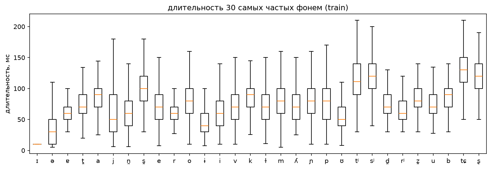
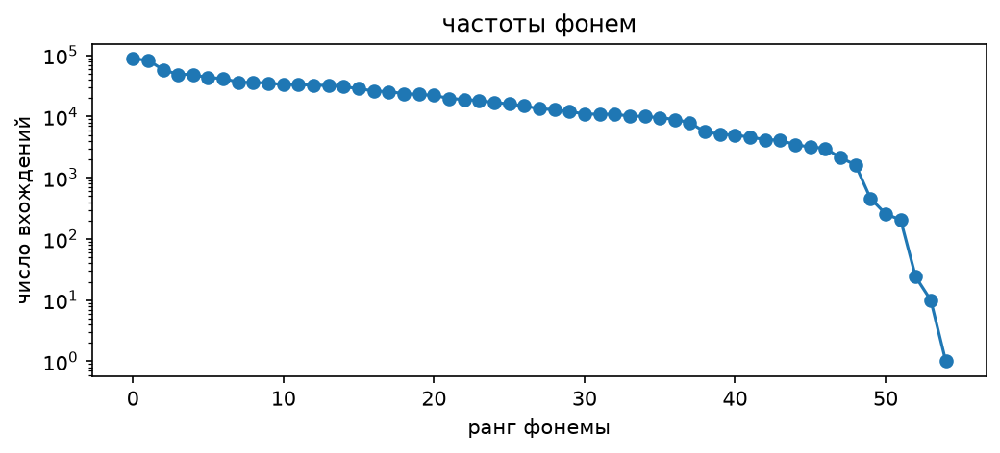

# Лабораторная работа №3. Транскрипция

Курс «Синтез речи», Университет ИТМО, 2026

**Выполнил:** Янкин Иван Ю., группа М4221

## Результаты

| Критерий | Порог | Результат |
|---|---|---|
| PER на связном тексте, `test` | ≤ 0,025 | ≈ 0,016 |
| PER на остатке (нет ни в одном словаре), `test` | ≤ 0,20 | ≈ 0,19 |
| Фонемы `metadata_phones.csv` ⊂ `phones_mfa.txt` | обязательно | выполнено (проверка при сборке) |
| Остаток транскрибируется своей моделью | обязательно | выполнено (правила) |

подготовлено 20 578 предложений.

## Разведочный анализ

**1. Фонемы корпуса, соотношение с IPA, длительности.**
55 фонем. Основные фонемы русского объясняются IPA.

**2. Редкие фонемы.**

**3. OOV-слова.**
Лексикон `train` почти полностью покрывает `train` и заметно хуже покрывает `test`: в тесте много редких словоформ. Словарь MFA покрывает `test` лучше лексикона. После обоих словарей остаётся небольшая доля токенов.

**4. Слова, на которых разметка не сработала (`spn`).**
Почти всех этих слов нет в словаре MFA. Две группы: слова с `ё` (лёву, казённой, хрущёвской) и иностранные имена и названия (хиллс, о'кей). Такие предложения удаляются целиком. Аббревиатуры, числительные и сокращения проверить нельзя: в выравнивании только предложения, прошедшие фильтр первой работы, а он их убрал.

**5. Омографы.**
делятся на два типа:
- `в`, `с`, `из` и подобные: настоящее озвончение и оглушение на стыке слов. Решается контекстом (следующее слово).
- `на`, `то`, `что`, `не` и прочие: полная или редуцированная гласная, написанием не определяется. Около половины вариантов отличаются только гласными, то есть ударением и редукцией.

`замок`: в лексиконе два варианта (крепость и замок на двери), но вхождений единицы. `замка` и `замке` однозначны. `все`/`всё`: нормализатор первой работы не различает их написание, поэтому слова `всё` в лексиконе нет, а различие есть только в звучании. Словарь MFA даёт для `всё` один вариант, для `все` два. По написанию их не различить, поэтому в G2P нет замены `ё→е`.

Омографы это 16,5 % слов `test`, но 35,6 % всех ошибок. Если бы они разрешались идеально, ошибка на `test` упала бы примерно вдвое. Это предел словарного метода без ударений в тексте.

## Модуль G2P

Источники по порядку: 
- `<SIL>` проходит без изменений, 
- затем лексикон `train`
- затем словарь MFA (самый вероятный вариант),
- затем части слова через дефис и в конце собственные правила.

Правила для остатка:
- подстановки написания: `что→што`, `-ться/-тся`, `сч/зч→щ`, упрощение групп согласных (`стн`, `здн` и др.), `гк/гч→хк/хч`, `-ого/-его→-ово/-ево`;
- ударение перед `ни` в `-ание/-ение` (`stress_nie`);
- смягчение согласной перед мягкой (`palatal`);
- оглушение на конце слова и ассимиляция по звонкости (`voicing`);
- схлопывание удвоенных согласных (`degemination`).

Всегда работают: транслитерация латиницы, эвристика ударения (явный знак, `ё`, единственная гласная, иначе предпоследняя), мягкость и йотация, редукция гласных по положению относительно ударения.

## Замеры

- Словарь MFA даёт основной прирост на слова вне лексикона, без него ошибка на OOV заметно выше. 
- Правила закрывают остаток, без них он остаётся без транскрипции. 
- Контекст на стыке слов дополнительно снижает ошибку, но только за счёт `в/с/из` и подобных.

Вклад отдельных правил: 
- наибольший у `voicing`, `degemination`, `palatal` и `stress_nie`, 
- умеренный у `ogo`, 
- у `chto`, `sch`, `clusters`, `gk` почти нулевой. Остаток на `test` мал (около 1,2 тыс. слов), поэтому различия в тысячных долях на нём в пределах шума. Ошибки для разбора правил берутся по словам `train`, `test` используется только для замеров.

Структура ошибки на `test`: 
- слова из лексикона с одним вариантом (72 % слов) дают лишь 7 % ошибок. 
- Омографы (16,5 % слов) дают 36 % ошибок. 
- Слова, которых нет нигде (2,5 % слов), дают больше половины ошибок: ударение и редукция гласных угадываются эвристикой. Остаток в основном состоит из редких длинных словоформ и заимствований.
## Ограничения

- Ударение в словах вне словарей угадывается эвристикой; омографы выбираются по частоте.
- Выбор между `все` и `всё` по написанию невозможен.
- Остаток на `test` мал, оценка отдельных правил на нём шумная.