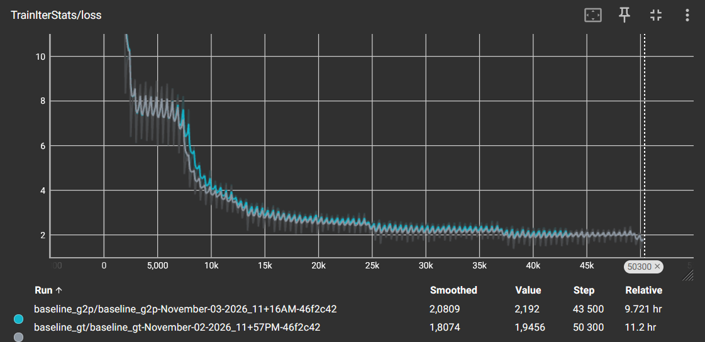
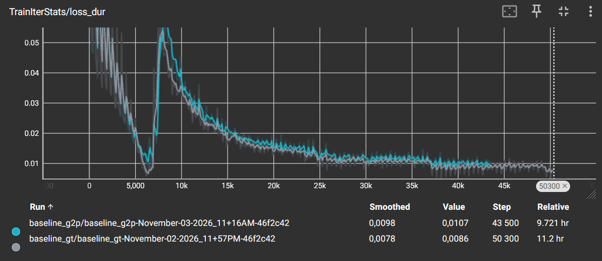
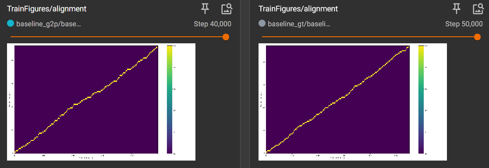
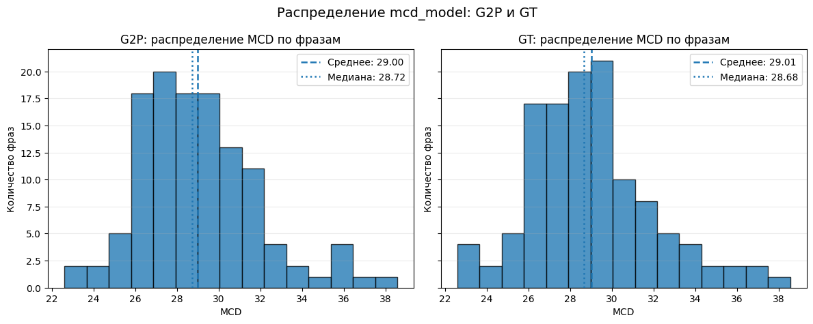
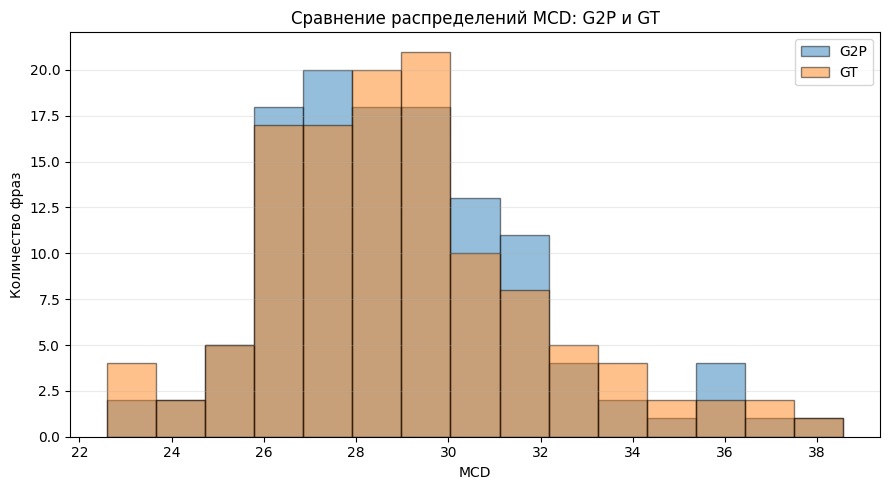

# Лабораторная работа №4. Акустическая модель FastSpeech2

Курс «Синтез речи», Университет ИТМО, 2026.

## 1. Цель и постановка

Обучить акустическую модель FastSpeech2 на корпусе RUSLAN: фонемы → мел-спектрограмма. Мел превращается в звук алгоритмом Гриффина-Лима. Сравниваются два варианта входных данных: фонемы из исходной разметки `gt` и фонемы, предсказанные моделью `g2p`.

**Окружение:**  
GPU: GTX 1080 Ti (11 ГБ), 4 ядра CPU; coqui-TTS.

## 2. Конфигурация

| параметр | значение |
|---|---|
| модель | FastSpeech2, внутренний выравниватель (`use_aligner`), без предикторов pitch/energy |
| энкодер / декодер | FFT-трансформер, по 6 слоёв, `hidden_channels` 384 |
| оптимизатор | Adam, `grad_clip` 5 |
| learning rate | 5e-3, планировщик NoamLR (прогрев 4000 шагов) |
| batch size | 32 |
| точность | fp32 |

**Выбор learning rate.**  
По методичке `5e-3` быстрее всего даёт звучащую речь. Расхождения не наблюдалось.

| запуск | фонемы | lr | шагов | время |
|---|---|---|---|---|
| `baseline_gt` | gt | 5e-3 | ≈ 50 тыс. | TODO |
| `baseline_g2p` | g2p | 5e-3 | TODO | TODO |

Оба запуска остановлены после выхода кривых на плато.

## 3. Ход обучения

- общий loss и loss длительностей убывают и выходят на плато. 
- выравнивание диагональное. 
- речеподобный звук появился на ранних этапах обучения, расхождения не было.

## 4. Результаты оценки

Значения усреднены по 120 фразам.

| метрика | `baseline_gt` | `baseline_g2p` |
|---|---|---|
| MCD модели | 29.0 | 29.0 |
| MCD постоянного мела | 62.1 | 62.1 |
| отношение числа кадров (модель / оригинал) | 1.01 | 1.01 |

- MCD модели ниже MCD постоянного мела в каждой из 120 фраз у обоих запусков. 
- абсолютные значения MCD высокие.

### Сравнение моделей

| набор | что слышно |
|---|---|
| `natural` | живая запись, эталон |
| `copysynth` | речь понятна |
| `model` | речь членораздельна и разборчива, но заметно роботизирована |

- gt и g2p по MCD, отношению длительностей и на слух варианты практически неразличимы. Преимущества `gt`-разметки не обнаружено.
- фонемы произносятся разборчиво, слова узнаваемы.
- интонация плоская, темп ровный, речь звучит роботизированно.

## 5. Что не получилось

- **звук роботизированный**: без предикторов высоты тона и энергии модель не получает явного сигнала об интонации, поэтому усредняет её.
- **gt идентична g2p:** узким местом качества является не вход, а акустическая модель и вокодер.